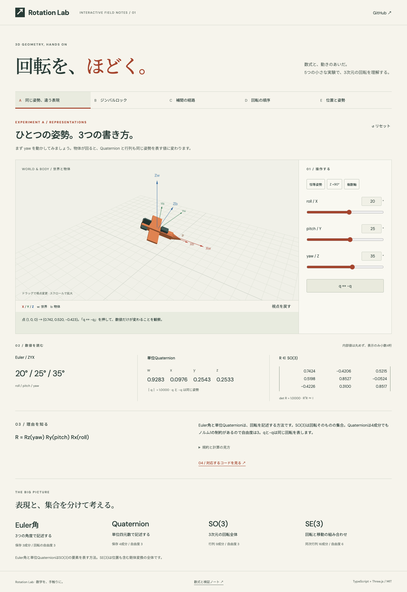

# Rotation Lab — 回転を、ほどく。

Euler角・単位Quaternion・SO(3)・SE(3)の関係を、5つの3D実験で触って理解する学習用デモです。日本語の説明、数値、対応コードをひとつの流れで読めます。

[デモを開く](https://yoshimasa1700.github.io/rotation-lab/) · [English](README.en.md) · [数学の規約](docs/conventions.md) · [検証ノート](docs/math-notes.md)

[](https://github.com/yoshimasa1700/rotation-lab/actions/workflows/pages.yml)



[補間の操作GIFを見る](public/interpolation.gif)（実画面をu=0.1刻みで記録）

## 5つの実験

| 実験 | 操作 | 観察すること |
| --- | --- | --- |
| A：同じ姿勢、違う表現 | roll・pitch・yaw、q ↔ −q | Euler、Quaternion、行列が同じ姿勢を表す |
| B：ジンバルロック | pitch 0° / 89° / 90°、同値姿勢 | (0°,90°,0°)と(30°,90°,30°)が同じ回転になる |
| C：補間の経路 | 2種類の始終点、補間率、再生・停止、unwrap | Euler成分補間とSLERPの経路・回転角の差 |
| D：回転の順序 | X/Y各90°の適用順を交換 | Rx Ry ≠ Ry Rx。点(0,0,1)の行き先が変わる |
| E：位置と姿勢 | 回転・移動・順序交換・逆変換 | 回転→移動で(1,1,0)、移動→回転で(0,2,0)、逆変換で元に戻る |

すべての実験に初期例とリセットがあります。3Dはドラッグで視点変更、スクロールで拡大。スライダーは矢印キー、数値欄は直接入力に対応しています。再生は自動で始まらず、停止・デモ切替・タブ非表示で止まります。

| 概念 | 意味 | 保存成分数 | 自由度 |
| --- | --- | --- | --- |
| Euler角 | 回転の表現 | 3 | 通常3、特異点で局所表現が退化 |
| 単位Quaternion | 回転の表現 | 4 | 3、ノルム1の制約 |
| SO(3) | 3次元の回転全体 | 行列なら9 | 3 |
| SE(3) | 回転＋移動の剛体変換全体 | 同次行列なら16 | 6 |

## 起動・検証

Node.js **24 LTS**を推奨（最低22.12）。依存バージョンは`package-lock.json`で固定しています。

```sh
git clone https://github.com/yoshimasa1700/rotation-lab.git
cd rotation-lab
npm ci
npm run dev
```

表示されたローカルURLを開きます。

```sh
npm test          # 数学・Three.js境界の22テスト
npm run build     # TypeScript型検査＋本番ビルド
npm run preview   # ビルドした静的サイトを確認
npx playwright install chromium # 初回のみ
npm run test:e2e  # 本番ビルド＋9つのブラウザ操作テスト
```

## 設計

数学コアはThree.jsに依存しません。右手系・列ベクトル・能動回転、Eulerは`Rz(yaw) Ry(pitch) Rx(roll)`、QuaternionはHamilton積の`(w,x,y,z)`順です。ライブラリ境界でThree.jsの`(x,y,z,w)`順へ変換します。

内部姿勢は単位Quaternionと位置で保持し、Eulerの編集値を別に持ちます。姿勢からEulerを逆算して入力値へ戻さないため、等価な角度へスライダーが突然飛びません。3Dシーンは変更時に描画し、補間再生中だけフレームを更新します。デモ切替時にはGPUリソースとイベントを解放します。

```text
src/math/                 独立したSO(3)・SE(3)計算
src/adapters/three.ts      成分順・行列格納順の境界
src/demos/content.ts       5つの実験の説明
src/ui/scene.ts            非対称物体・座標軸・ジンバル・軌跡
src/main.ts               状態・操作・数値表示
tests/math.test.ts        既知解・境界条件・固定seedの不変条件
e2e/                     入力・フォーカス・補間・狭い画面の操作テスト
```

## 公開

GitHub ActionsはPRで数学テスト・型検査・ビルド・Chromiumによる9つの操作テストを実行し、`main`へのpush後にGitHub Pagesへ配信します。別のリポジトリで使う場合はSettings → Pages → Sourceを**GitHub Actions**に設定してください。Viteの`base: './'`により、リポジトリ配下URLでもアセットを解決できます。

[実装計画（開始時の記録）](docs/project-plan.md)と[設計の振り返り](docs/retrospective.md)も公開しています。現在の仕様はREADME・規約・コード・テストを参照してください。

## 制約

- WebGL対応ブラウザが必要。非対応時も数値と操作は利用可能です。
- 日本語UIが中心です。任意行列・Quaternionの直接編集、Euler逆変換、Lie代数は含みません。
- SLERPは近接姿勢で正規化線形補間に切り替えます。この近似枝では厳密な等角速度ではありません。
- 「始点からの回転角」は最短角距離で、回転の積算量ではありません。
- 外部フォントを取得できない環境では端末のフォントを使います。

操作性の改善と再現手順は[監査記録](docs/audit-2026-10-15.md)を参照してください。

MIT License
