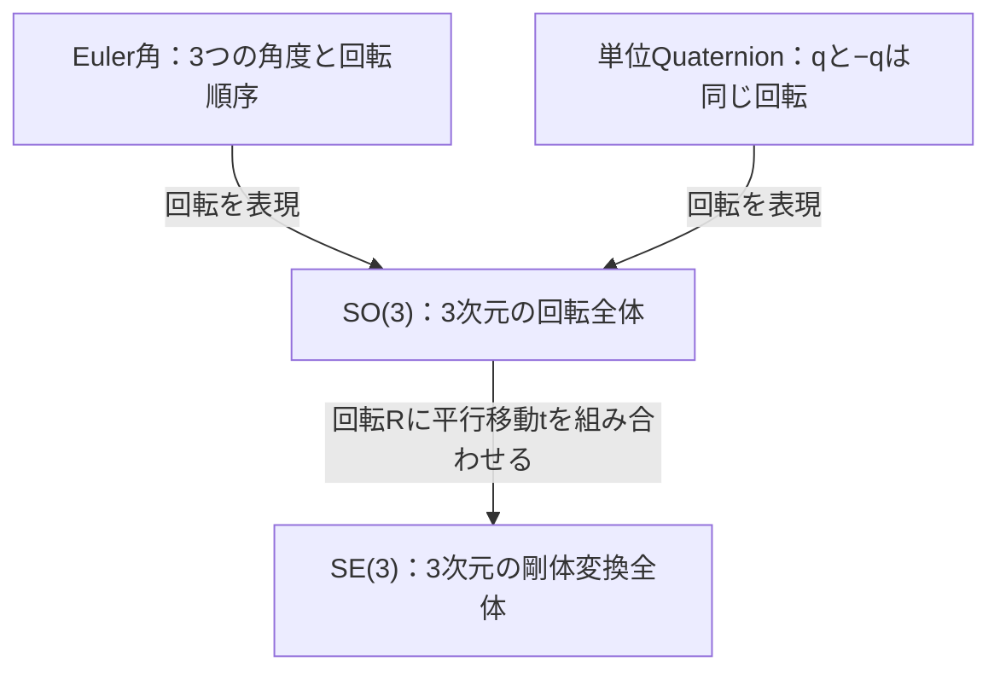

# Rotation Lab：3次元回転と剛体変換を触って理解する

> [!abstract] 目標
> Euler角・Quaternion・SO(3)・SE(3)の関係を、3D表示と数値を操作して理解できるデモを作る。解説・実装・検証を公開リポジトリにまとめ、数学をソフトウェアに落とし込む力を示すポートフォリオにする。

現段階の成果物はこの計画書。実装、リポジトリ作成、サイト公開は今後の工程とする。プロジェクト名・技術構成・公開先は以下の提案を初期案とする。

> 実装時の注記：この文書は2026-10-15の開始時点の計画を保存したものです。A〜Eの実装内容と現在の仕様はREADME、conventions.md、math-notes.mdを参照してください。

## 1. まず押さえる違い

**Euler角と単位Quaternionは回転の表現方法。SO(3)は3次元の回転全体、SE(3)は回転と平行移動を組み合わせた剛体変換全体を表す数学的な群である。** 群とは、ここでは変換を合成でき、何もしない変換と元に戻す変換を持つ構造と考える。

| 名前 | 何を表すか | 通常保存する数値 | 自由度 | 主な特徴・注意点 |
| --- | --- | --- | --- | --- |
| Euler角 | 軸と順序を決めた3回転による姿勢 | 3角度 | 3。ただし特異点では局所的に独立な3変数として使えない | 人が操作しやすい。順序依存、角度の折り返し、ジンバルロックがある |
| 単位Quaternion（四元数） | 回転の別の表現 | 4成分、ノルム1 | 3 | 回転合成・補間に便利。`q`と`−q`が同じ回転を表す |
| SO(3) | 3次元の回転全体 | 標準的には3×3回転行列の9成分 | 3 | 行列には直交性と行列式の条件がある。回転の合成は一般に順序に依存する |
| SE(3) | 3次元の回転＋平行移動全体 | 標準的には4×4同次変換行列の16成分 | 6＝回転3＋移動3 | 物体・カメラ・ロボットの位置と姿勢をまとめて扱う |

保存する数値の個数と自由度は異なる。Quaternionは一般には4自由度だが、回転に使う**単位**Quaternionにはノルム1の制約がある。SE(3)の要素は、4×4行列以外に単位Quaternionと3次元位置の組でも保存できる。



単位Quaternionの集合はSO(3)を「二重被覆」する。1つの回転に対し`q`と`−q`という2つの表現が対応する、という意味から説明する。Euler角も周期性や特異点により、1つの回転に一意には対応しない。

### デモ全体で使う式

$$
SO(3)=\{R\in\mathbb{R}^{3\times3}\mid R^\top R=I,\ \det R=1\}
$$

$$
SE(3)=\left\{T=\begin{bmatrix}R&t\\0_{1\times3}&1\end{bmatrix}\mid R\in SO(3),\ t\in\mathbb{R}^3\right\}
$$

$$
p'=Rp+t,\qquad
\begin{bmatrix}p'\\1\end{bmatrix}=T\begin{bmatrix}p\\1\end{bmatrix}
$$

SO(3)だけでは平行移動を扱わない。SE(3)は拡大縮小・せん断・鏡映を含まない。位置と姿勢を表す剛体変換に対象を絞る。

## 2. 誰が、何を理解できるようにするか

対象は、3D・ロボティクス・画像処理に関心があり、ベクトルと行列の基礎を学んだ人。導入は図と操作で理解できるようにし、必要に応じて式とコードまで読める構成にする。

体験後に、次を自分の言葉で説明できることを目指す。

- Euler角・単位Quaternion・回転行列で同じ姿勢を表せる理由。
- ジンバルロックで起きる問題と、物体の回転自由度そのものが減るわけではないこと。
- Euler角の成分補間とQuaternionによるSLERPの違い。
- 回転や剛体変換は、適用する順序によって結果が変わること。
- 「向きだけ」と「位置＋向き」の違い、および座標変換の元と先。

## 3. デモの構成

最小実用版（MVP）はA・B・Eの3本にする。これで4概念の関係、Euler角の特異点、SE(3)の役割まで扱える。C・Dを追加して公開版v1.0を完成させる。

すべてのデモに「操作する → 結果を見る → 理由を読む → 対応コードを見る」の導線を設ける。

### A. 同じ姿勢を異なる表現で見る【MVP】

- **操作：** roll・pitch・yawを変更する。恒等姿勢、Z軸90°回転、複数軸回転のプリセットを選ぶ。`q ↔ −q`を切り替える。
- **表示：** 向きが区別できる非対称の物体、世界座標軸と物体座標軸、Euler角、単位Quaternion、3×3回転行列。
- **学び：** 表現が変わっても姿勢は同じ。4成分や9成分を持っていても回転の自由度は3。
- **合格条件：** `q`の符号を反転しても姿勢と回転行列が変わらない。Z軸+90°回転で`(1,0,0)`が`(0,1,0)`になる。

初版ではEuler角を入力、Quaternion・行列を出力として始める。任意の行列やゼロQuaternionを入力させる編集機能は後回しにし、学習の焦点を保つ。

### B. ジンバルロックを観察する【MVP】

- **操作：** ZYX規約のpitchを0°、89°、90°へ変更し、rollとyawを動かす。
- **表示：** 入れ子の回転軸、物体、現在の姿勢。pitch=90°ではrollとyawの変化が独立に姿勢へ反映されなくなることを示す。
- **学び：** 特異点ではEuler角の局所的な表現が退化する。物体自体は引き続き3次元の回転が可能。
- **合格条件：** `(roll,pitch,yaw)=(0°,90°,0°)`と`(30°,90°,30°)`が同じ回転行列になることを、図と数値で確認できる。

Quaternionにも同じ姿勢を表示する。ただし、特異なEuler角入力をQuaternionへ変換しただけで入力操作の退化が解消する、という説明にはしない。独立した回転操作を比較する場合は、Quaternion側に軸角による増分回転を用意する。

### C. 補間の経路を比較する【v1.0】

- **操作：** 始点と終点の姿勢を選び、補間率`u ∈ [0,1]`を変更・再生する。
- **表示：** Euler角各成分の線形補間と、単位QuaternionのSLERPを横並びに表示する。物体上の目印の軌跡も描く。
- **例1：** yaw `+179° → −179°`。単純な数値補間が大回りになることと、角度のunwrapでもこの問題を改善できることを示す。
- **例2：** `(roll,pitch,yaw)=(0°,0°,0°) → (90°,60°,120°)`。複数軸の姿勢変化で経路と角速度の違いを示す。
- **学び：** 角度の折り返しへの対処と、3次元回転としての補間は別の問題。SLERPは短い経路を選ぶ符号調整と、一定速度のパラメータ進行によって一定の回転角速度を与える。
- **合格条件：** 両方式の始点・終点が同じ姿勢になり、中間経路を比較できる。SLERPで符号反転やほぼ同一姿勢からNaNが生じない。

SLERPは内積が負なら片方のQuaternionの符号を反転し、内積を丸め誤差に備えてclampする。ほぼ同一姿勢では正規化線形補間などに切り替える。相対回転が180°の場合は最短経路が一意に決まらないことを補足する。

### D. 回転順序を入れ替える【v1.0】

- **操作：** X軸90°回転とY軸90°回転の順序を交換する。
- **表示：** `Rx(90°)Ry(90°)`と`Ry(90°)Rx(90°)`の結果、適用順序、行列積を比較する。
- **学び：** 回転は一般に非可換。列ベクトル規約では式の右側から適用する。
- **合格条件：** 点`(0,0,1)`は、前者では`(1,0,0)`、後者では`(0,−1,0)`となる。

UIには行列の並びだけでなく「Y回転 → X回転」のように実際の操作順を表示する。

### E. SE(3)で位置と姿勢を扱う【MVP】

- **操作：** 物体の回転と平行移動を変更する。「回転 → 移動」「移動 → 回転」を切り替え、逆変換も適用する。
- **表示：** 世界と物体の座標軸、物体上の点、変換前後の座標、4×4同次変換行列。回転ブロック`R`と移動ベクトル`t`を色とラベルで対応付ける。
- **学び：** 向きと位置を一緒に扱う意味、変換順序、ローカル座標と世界座標の関係。
- **合格条件：** 世界座標の点`p=(1,0,0)`に、世界原点を通るZ軸まわりの+90°回転と、世界座標のX方向への+1移動を適用する。回転→移動で`(1,1,0)`、移動→回転で`(0,2,0)`になる。逆変換で元の点に戻る。

変換の合成と逆変換も示す。

$$
T_1T_2=
\begin{bmatrix}
R_1R_2&R_1t_2+t_1\\
0_{1\times3}&1
\end{bmatrix},\qquad
T^{-1}=
\begin{bmatrix}
R^\top&-R^\top t\\
0_{1\times3}&1
\end{bmatrix}
$$

移動量の単純な足し算では合成できない理由を、`R₁t₂`と座標軸の向きから説明する。

## 4. 数学と実装の規約

画面・解説・テストで以下を共通にし、READMEから参照できる独立した規約ページにもまとめる。

| 項目 | 採用する規約 |
| --- | --- |
| 座標系 | 右手系。世界軸はX＝赤、Y＝緑、Z＝青。文字ラベルを併用する |
| ベクトル | 列ベクトル。回転デモは能動回転`p′=Rp`として説明する |
| Euler角 | `R = Rz(yaw) Ry(pitch) Rx(roll)`。内因性ZYX、等価な外因性XYZでは固定X→Y→Zの順で適用する |
| 角度 | UIは度、内部計算はラジアン |
| Quaternion | 単位Quaternion、Hamilton積、数学上とUIの成分順は`(w,x,y,z)` |
| Quaternion合成 | `R(q₁q₂)=R(q₁)R(q₂)`。列ベクトルでは`q₂`の回転が先 |
| 点の座標変換 | `p_A = T_A_from_B p_B`。同次座標を用い、`T_A_from_B`はB座標で表した点をA座標へ写す |
| 座標変換の合成 | `T_A_from_C = T_A_from_B T_B_from_C`。変換元・変換先の添字を省かない |
| 表示精度 | 表示は丸めても内部値は丸めない。移動はデモ内の共通単位を使う |

回転デモの「点を回す」操作と、座標系デモの「同じ点を別の座標で表す」操作は、図中のラベルと説明で区別する。

Three.jsのQuaternion APIは`(x,y,z,w)`順なので、境界で明示的に変換する。行列の表示上の行・列と、ライブラリ内部の配列格納順も区別する。Three.jsのEuler指定は規約式と一致する`ZYX`を使い、既知の回転例で確認する。

内部状態は単位Quaternionと位置を基準にする。Euler入力は編集状態として別に保持し、変換の往復でスライダーが突然別の等価角度へ飛ばないようにする。Euler角への逆変換では複数解や特異点があることを表示する。

## 5. 技術構成と公開先の案

**ブラウザで動く静的サイトを作り、コードをGitHub、デモをGitHub Pagesで公開する構成を第一候補にする。** インストール不要で試せて、リポジトリから実演へすぐ進めるため、公開実績として見てもらいやすい。

| 役割 | 初期案 | 選ぶ理由 |
| --- | --- | --- |
| 実装言語 | TypeScript | 回転・姿勢・座標のデータ構造を明示する |
| 開発・ビルド | Vite | 静的サイトとして開発・配布しやすい |
| 3D表示 | Three.js | 物体、座標軸、軌跡、カメラ操作を実装する |
| 数学コア | 小さな独立モジュール | 変換・補間の式とコードを対応付け、UIなしで検証できるようにする |
| 数値テスト | Vitest | 既知解、境界条件、変換の不変条件を検証する |
| 公開 | GitHub＋GitHub Pages＋GitHub Actions | ソース、検証結果、動くデモをひとつの導線にする |
| 計画・学習メモ | Obsidian | この計画書や学習中の記録をMarkdownで残す |

「Pages」がChatGPT Pagesを指す場合は、要約や検討メモの置き場として追加できる。実行可能なデモと公開コードの中心はGitHub側に置く案とする。現段階では公開先は未確定。

初版はTypeScriptとThree.jsで始め、UIの複雑さに必要が生じたらReact等を検討する。Python版やNotebookは、ブラウザ版が完成した後の拡張候補とする。

### 想定リポジトリ

```text
rotation-lab/
├── README.md                 # 日本語の導入・実演リンク・起動手順
├── README.en.md              # 公開時に英語の要約を追加
├── LICENSE                   # MITを候補に、採用時に確定
├── package.json
├── index.html
├── src/
│   ├── math/
│   │   ├── rotation.ts       # Euler / Quaternion / SO(3)
│   │   └── rigid-transform.ts # SE(3)の合成・逆変換・点変換
│   ├── adapters/three.ts     # 成分順・行列格納順の変換
│   ├── demos/               # A〜Eのデモ
│   ├── ui/                  # スライダー、数値表示、解説
│   └── main.ts
├── tests/                    # 数学とライブラリ境界の検証
├── docs/
│   ├── project-plan.md
│   ├── conventions.md
│   └── math-notes.md
├── public/                   # 画面画像、動画、静的アセット
└── .github/workflows/        # テスト・ビルド・Pages配信
```

計画段階の原本はObsidianに置く。リポジトリ公開時に必要な計画と規約を`docs/`へ移し、以後の公開仕様の原本をリポジトリにする。Obsidianには学習ログとリンクを残し、公開仕様の二重管理を避ける。

## 6. 正しさと使いやすさの確認

### 数学の検証

- [ ] 恒等回転と各軸±90°回転を、手計算できる期待値と照合する。
- [ ] `RᵀR ≈ I`、`det(R) ≈ 1`、`‖q‖ ≈ 1`を確認する。
- [ ] 変換の往復はEuler角の成分一致ではなく、回転行列または符号に依存しないQuaternion比較で評価する。
- [ ] `q`と`−q`の回転が一致し、SLERPも両者を同じ姿勢として扱えることを確認する。
- [ ] ジンバルロックの既知例、pitch=±90°とその近傍、±180°付近、ほぼ同じ姿勢を含める。
- [ ] `T⁻¹T ≈ I`、合成した変換と逐次変換の結果一致を確認する。
- [ ] A〜Eの「合格条件」をテストまたは画面操作で再現する。
- [ ] 固定seedのランダム姿勢でも不変条件を確認する。
- [ ] Three.jsとの成分順・積順の境界を既知解で検証し、同じ実装を呼び直すだけのテストにしない。

JavaScriptの倍精度計算を前提に、通常の小さな入力で行列・点の誤差`1e-9`程度を初期基準にする。逆三角関数や特異点近傍は評価量と許容誤差の理由を明記する。画面の丸め表示とテストの許容誤差は分ける。

### 画面と配布の確認

- [ ] 初めて開いて、最初の操作と観察点がわかる。
- [ ] すべてのデモにプリセットとリセットがある。
- [ ] 座標軸と回転方向を色だけに依存せず識別できる。
- [ ] 数値とスライダーをキーボードでも操作できる。
- [ ] アニメーションを停止でき、狭い画面でも説明が読める。
- [ ] 新規cloneからREADMEの手順で起動・テスト・ビルドできる。
- [ ] GitHub Pagesのリポジトリ配下URLでもアセットが読み込める。

## 7. 実施順と各段階の完了条件

| 段階 | 作るもの | 完了条件 |
| --- | --- | --- |
| P0：計画 | このノート、規約、範囲 | 4概念の関係と各デモの目的・合格条件が記述されている |
| P1：最初の実演 | 開発環境、数学コア、デモA | スライダーで物体が回り、Euler角・Quaternion・行列が同期する。既知回転のテストが通る |
| P2：MVP | デモB・E、説明、逆変換 | 特異点と剛体変換の違いを再現でき、A・B・Eの合格条件を満たす |
| P3：公開版の内容 | デモC・D、比較画面 | 補間経路と回転順序を比較でき、境界条件のテストが通る |
| P4：公開準備と公開 | README、規約、画像・短い動画、CI、Pages | 新規環境で再現可能。公開デモからコード、コードからデモへ移動できる |
| P5：実績の整理 | v1.0リリース、設計の振り返り | 何を作り、どの誤解を防ぎ、どう検証したかを証拠付きで説明できる |

日程はP1を実装してから見積もる。まずAだけを縦に完成させ、数学・描画・UIの接続方法を確認してから残りへ広げる。

### 次に着手する小さなタスク

- [ ] 仮名`rotation-lab`でローカルのプロジェクトを初期化する。
- [ ] 規約を`docs/conventions.md`にまとめる。
- [ ] 恒等回転とZ軸90°回転を計算し、既知解で検証する。
- [ ] 非対称の物体と世界・物体の座標軸を表示する。
- [ ] roll・pitch・yawスライダーとQuaternion・行列の同期表示をつなぐ。
- [ ] デモAを短い説明付きで試せる状態にする。

## 8. 公開実績として伝えること

見せたいのは「3D物体が回る」ことに加え、数学的な違いを説明し、規約の食い違いを防ぎ、特異点や境界条件まで検証できること。

READMEには、完成後の事実に基づいて次を載せる。

1. 動くデモへのリンクと、短い操作動画またはGIF。
2. 4概念の比較表と、代表的な操作例。
3. 採用した規約と設計上の判断、その理由。
4. 実行・テスト・ビルド手順、CIの結果。
5. 対応範囲、既知の制約、今後の拡張。

実績紹介文の素案：

> Euler角・Quaternion・SO(3)・SE(3)の関係を学べる対話型3Dデモを開発。ジンバルロック、回転補間、剛体変換の合成を可視化し、数学コアを既知解と境界条件で検証した。

この文章は完成後に実装範囲に合わせて更新する。未実装の機能や測定していない効果を実績として記載しない。

## 9. 初版の範囲外と拡張候補

- Lie代数`so(3)`・`se(3)`、指数写像・対数写像、twist、ヤコビアン。
- ロボットアームの順運動学、カメラ外部パラメータ、SLAMへの応用。
- Python／SciPy版、Notebook教材、データの入出力。
- 任意の回転順序の切り替え、行列直接編集、完全な多言語UI。

これらはv1.0が完成した後に検討する。最初は4概念の関係を自分で説明できるデモを完成させる。

## 10. 実装時に参照する資料

以下は参照候補。利用するライブラリのバージョンを固定する段階でAPIと規約を再確認する。

- [Modern Robotics](https://modernrobotics.northwestern.edu/)：剛体運動、SO(3)、SE(3)の背景。
- [SciPy Rotation](https://docs.scipy.org/doc/scipy/reference/generated/scipy.spatial.transform.Rotation.html)：回転表現と変換の参照。
- [Three.js Quaternion](https://threejs.org/docs/#api/en/math/Quaternion)／[Euler](https://threejs.org/docs/#api/en/math/Euler)：描画ライブラリのAPIと成分・回転順序。
- [GitHub Pages documentation](https://docs.github.com/en/pages)：静的サイトの公開方法。

## 11. 決定メモ

| 項目 | 現在の案・状態 |
| --- | --- |
| プロジェクト名 | Rotation Lab／リポジトリ名`rotation-lab`（仮） |
| 対象読者 | ベクトル・行列の基礎を学んだ3D／ロボティクス初学者 |
| 表示言語 | 日本語を先に完成。公開時に英語のREADME要約を追加 |
| 初期構成 | TypeScript＋Vite＋Three.js＋Vitest |
| 公開先 | GitHubリポジトリ＋GitHub Pagesを第一候補 |
| ライセンス | MITを候補に公開準備時に確定 |
| Obsidian保存先 | 未指定。現在はVaultに取り込める単独Markdownとして用意 |
| 現在の状態 | 計画作成。デモの実装・公開は未着手 |
